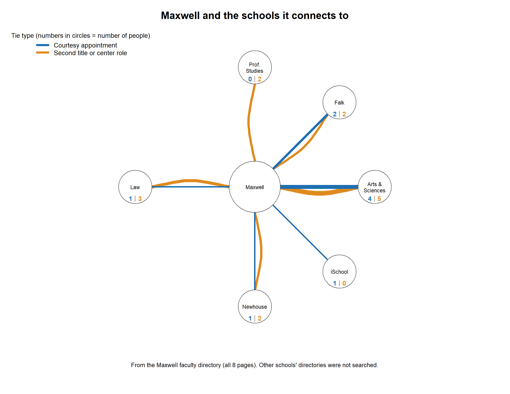
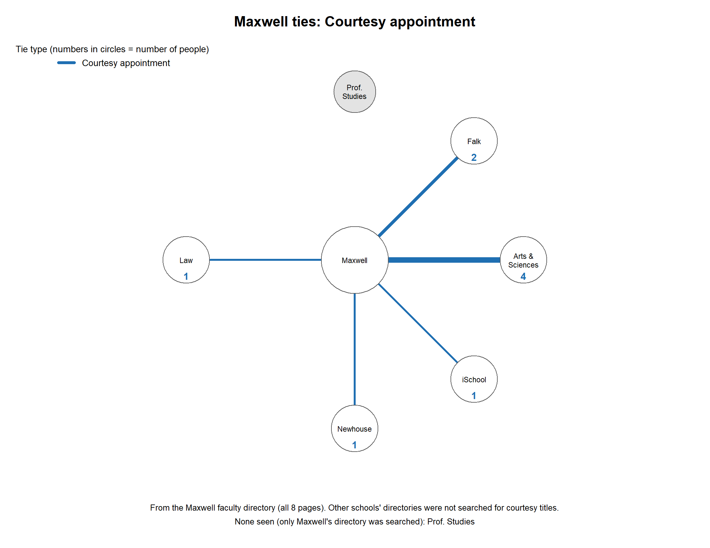
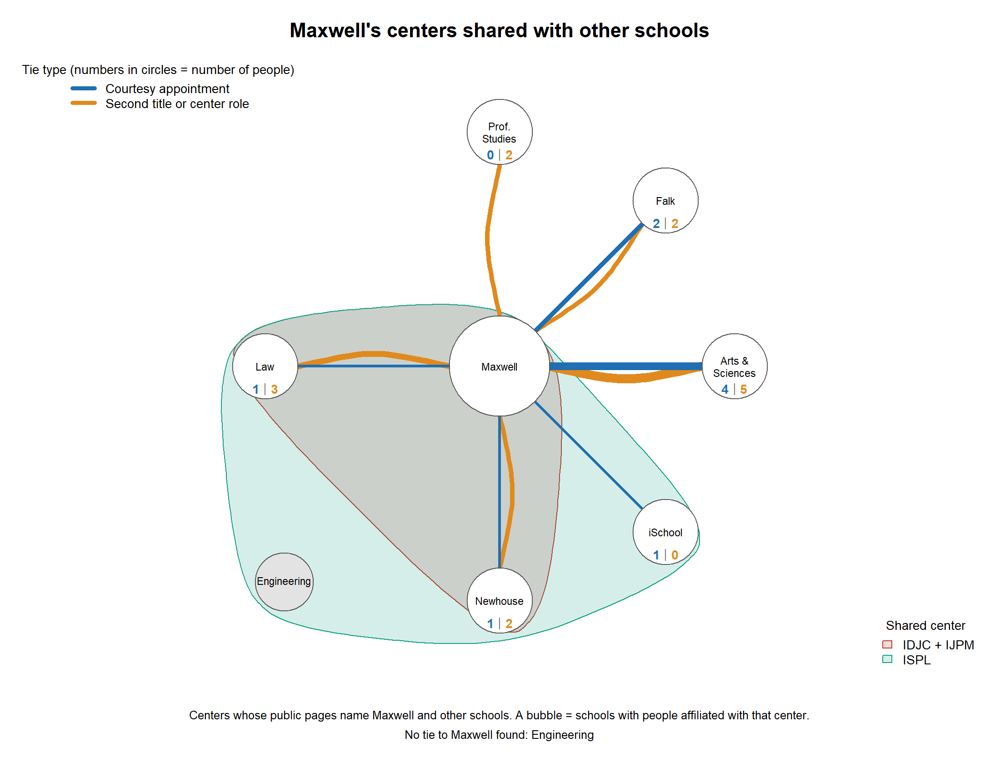

# How Syracuse University's schools connect: a Maxwell-centered pilot

A small network built from public web pages. The **nodes** are SU's 13 schools and colleges. A **tie** is a person whose public page shows a link between two schools. The project starts from the Maxwell School because its faculty directory was the one source searched systematically, and it shows what a fuller, team-built version could look like.

Author: _(Josh Arden)_ · Course: _(PAI 724)_

## What it found

Maxwell's faculty directory (all 8 pages) shows **23 people** who link Maxwell to six other schools:

| School | Courtesy appointment | Second title or center role | Total |
|---|---|---|---|
| Arts & Sciences | 4 | 5 | 9 |
| Falk | 2 | 2 | 4 |
| Law | 1 | 3 | 4 |
| Newhouse | 1 | 2 | 3 |
| Professional Studies | 0 | 2 | 2 |
| iSchool | 1 | 0 | 1 |

- Six schools (Architecture, Education, Engineering, the Graduate School, VPA and Whitman) have **no tie to Maxwell** in this directory. That means none seen, not none exist.
- Three centers that include Maxwell name people from several schools. **Law and Newhouse sit together in all three** (one is currently on hiatus), but no one linking Law and Newhouse was found. Nobody searched for that tie, so it is a lead, not a finding.
- The 15 pairs among Maxwell's six partner schools were never searched. Three of them share a Maxwell center (Law–Newhouse, Law–iSchool, iSchool–Newhouse), which makes them the best pairs to test first.

Blue numbers are courtesy appointments, orange numbers are second titles or center roles. More figures are in [`figures/`](figures/).

## The model

- **Nodes:** the 13 schools and colleges on SU's official list. Units inside a school roll up to it (School of Design and Drama are VPA; Political Science and Anthropology are Maxwell).
- **Tie type 1, courtesy appointment:** a Maxwell directory entry says "by Courtesy Appointment" and names another school as the person's home. This is the strictest tie.
- **Tie type 2, second title or center role:** an entry lists a second school or a center role without the courtesy wording. Looser.
- **Tie type 3, teaching, advising, course or project:** found for other schools (for example advisers to Newhouse's Goldring program). Kept in the data, not in the Maxwell-only figures, because it was not searched systematically.
- **Bubbles:** shared centers whose public pages name people from several schools. A bubble is a grouping, not a tie.
- The figures are undirected. A line means people link the two schools.

## How far to trust it

- **Systematic:** Maxwell's faculty directory, all 8 pages. Every tie in the Maxwell-only figures comes from it.
- **A sample:** everything else (Newhouse's list for advising roles, a few bios, four centers' pages). No other school's directory was searched for any tie type.
- **Maxwell looks like the hub partly because of where we looked.** Do not read its prominence as a finding about the university.
- **Home-school pages often do not mention the connection.** In five spot checks, two did. Silence on a page is not evidence of no tie.
- The data names faculty members as listed on public SU web pages. Five of the 23 Maxwell rows are retired titles (`retired = yes`).
- Co-authored publications were tested as a possible tie and set aside: SURFACE records one school per item and no school per author. Two unverified leads are in `pilot_candidates.csv`.

## Submission checklist

| Required | In this repo |
|---|---|
| R script(s) | `network_figures.R` |
| Quarto write-up with the graphics | `network_writeup.qmd` (reads the figures from `figures/`) |
| Compiled PDF of the write-up | `network_writeup.pdf` (made by rendering the `.qmd`) |
| Data in a format R can read | `nodes.csv` (node list), `edgelist_maxwell.csv` (edge list used in the figures), `edges_evidence.csv` (one row per piece of evidence), `centers.csv` |

## Files

| File | What it is |
|---|---|
| `nodes.csv` | The 13 schools. `id` is the short code used everywhere. |
| `edgelist_maxwell.csv` | The edge list used in the Maxwell-centered figures: `from`, `to`, `layer`, `weight` (number of people). |
| `edges_evidence.csv` | One row per piece of evidence (35 rows). The script counts these into edge weights. |
| `centers.csv` | Which schools belong to each shared center, one row per center-school pair. |
| `pilot_candidates.csv` | Two unverified co-authorship leads. Not used in the figures. |
| `layout.csv` | Hand-placed positions (`id`, `x`, `y`). Delete it and the script uses an automatic layout. |
| `network_figures.R` | Builds the figures and tables with the igraph package. |
| `network_writeup.qmd` | The Quarto write-up: network definition, data sources, data management, and what is noteworthy. |
| `figures/` | Output of the script: six figures and three tables. `figures/writeup/` holds copies of the six figures with the white margins trimmed, which the write-up uses so the labels stay readable. |

### Columns in `edges_evidence.csv`

| Column | Meaning |
|---|---|
| `id` | Row name. C = courtesy, B = second title or center role, P = teaching, advising, course or project. |
| `layer` | `courtesy`, `broad` (second title or center role) or `program`. |
| `school_1`, `school_2` | The two schools. Order does not matter. |
| `home_school`, `host_school` | Where the source says which school is home. Blank if unclear. Not used in the figures. |
| `who` | The person, center or program. |
| `wording_summary` | A condensed summary of the title lines, not a quotation. Check the source before quoting. |
| `source` | Where it was found, such as "Maxwell directory p7". |
| `confidence` | `strong` (stated plainly), `moderate` (stated with a caveat), `weak` (inferred or affiliate-only). |
| `retired` | `yes` if the title says emeritus or emerita. |
| `second_check` | `yes` if the wording was confirmed by a second, separate reading (28 of 35 rows). |
| `coverage` | `maxwell_directory` (23 rows), `newhouse_directory` (7) or `incidental` (5, found while reading something else). |
| `collected` | Month the page was read. |
| `notes` | Caveats for the row. |

### Rules used

1. A tie must be written on a public page and must name, or clearly point to, two different schools.
2. Not counted: ties inside one school, university offices (Office of Research, SU Abroad), outside institutions (SUNY ESF, SUNY Upstate), students, and editors of a book a person contributed to.
3. Titles that only say "Faculty Affiliate" of a program are marked `weak`.
4. Women's and Gender Studies is treated as part of Arts & Sciences because a Maxwell directory title says so.

## Running it

1. Put all the files in one folder and run `setwd("that/folder")` in R.
2. First time only: `install.packages("igraph")`.
3. `source("network_figures.R")`.

At the top of the script, `maxwell_only <- TRUE` (the default) draws only ties that touch Maxwell and writes to `figures/`:

- `maxwell1_star.png`: Maxwell and its six partner schools.
- `maxwell2_courtesy.png`, `maxwell2_broad.png`: one tie type each. Grey circles have no tie of that type.
- `maxwell3_all_bubbles.png`, `maxwell3_ISPL.png`, `maxwell3_IDJC_IJPM.png`: the centers that include Maxwell. IDJC and IJPM have the same member schools, so they share one bubble.
- `maxwell_partner_counts.csv`, `maxwell_untested_pairs.csv`, `maxwell_center_members_no_tie.csv`.

Other switches: `show_counts` (numbers inside circles), `include_retired`, `include_weak`, `include_incidental`. Setting `maxwell_only <- FALSE` draws the full network with all schools and all three tie types. That mode ran in an earlier version and has not been re-run since the dashed-line (incidental ties) change.

## Rendering the write-up

Open `network_writeup.qmd` in RStudio and click **Render**, or run `quarto render network_writeup.qmd` in a terminal. This writes `network_writeup.pdf` next to it. If Quarto reports that LaTeX is missing, run `quarto install tinytex` once and render again.

## Extending it

Each person can take one school. Search that school's directory, bios and center pages for second-school titles, then add rows to `edges_evidence.csv` with a unique `id`, the two school codes, a layer, the source and a confidence, and rerun the script. The pairs in `figures/maxwell_untested_pairs.csv` are the best place to begin.
