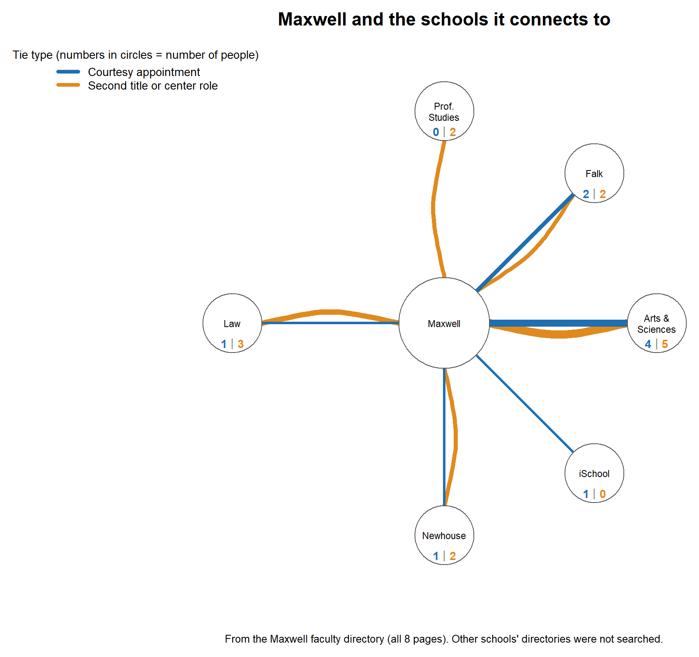
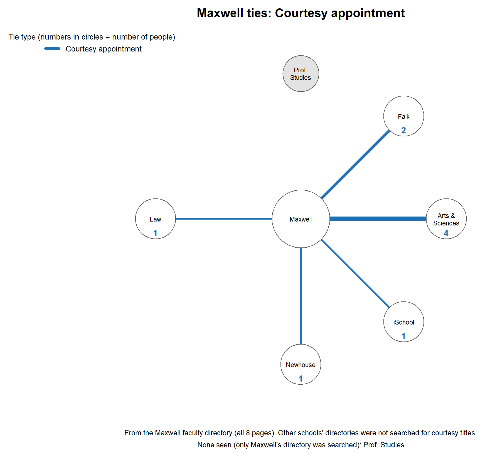
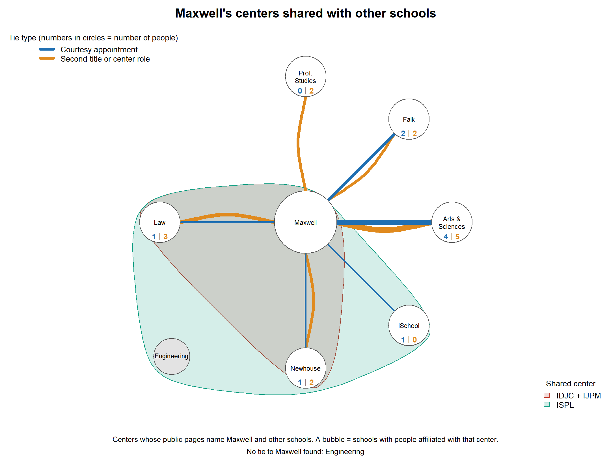
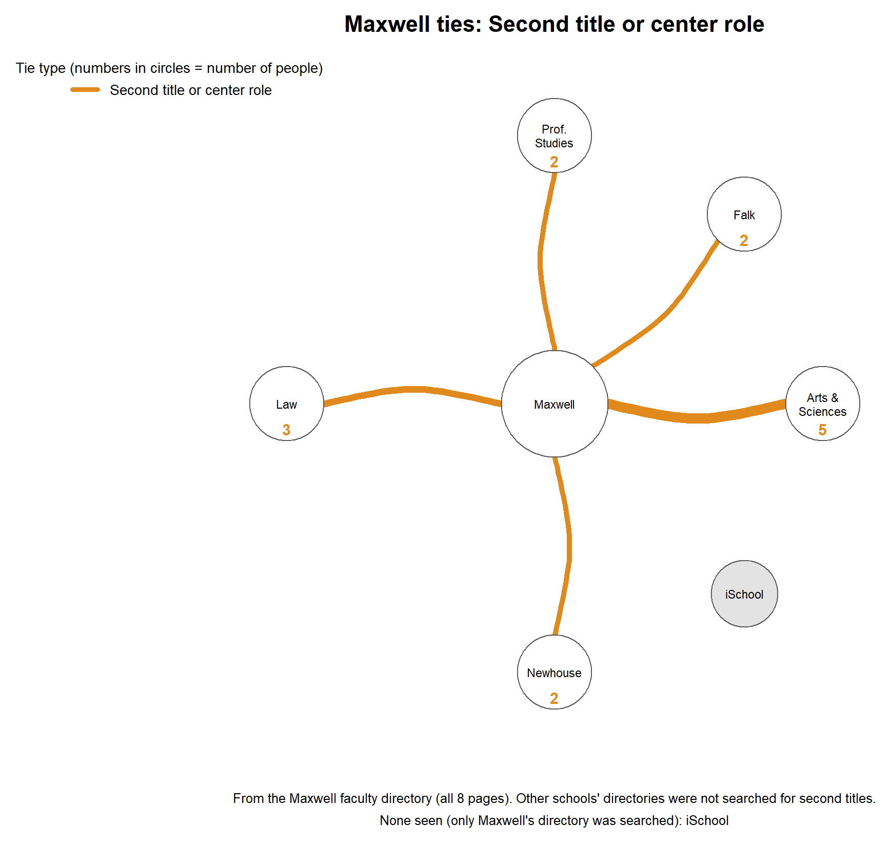
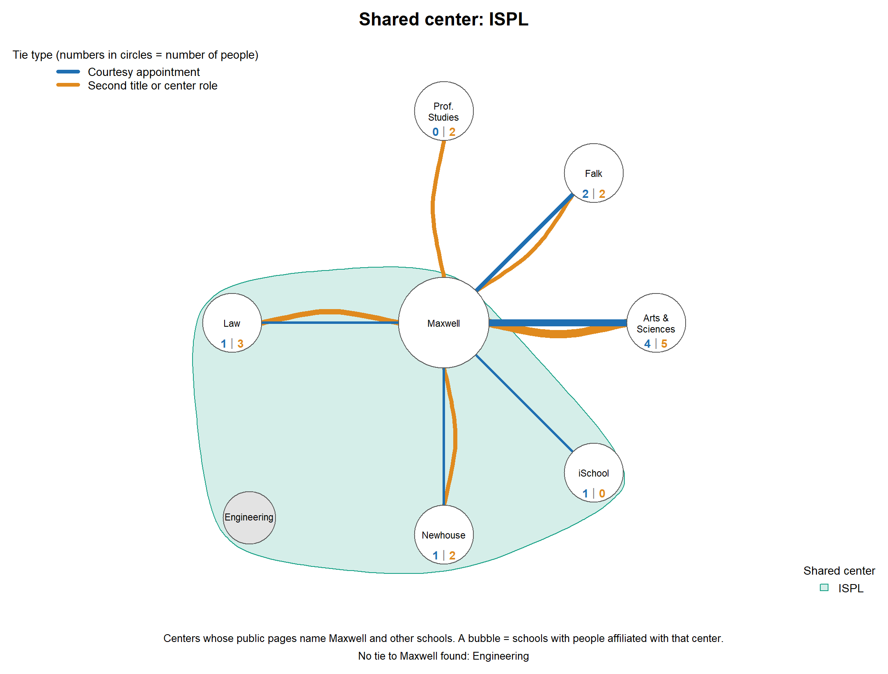
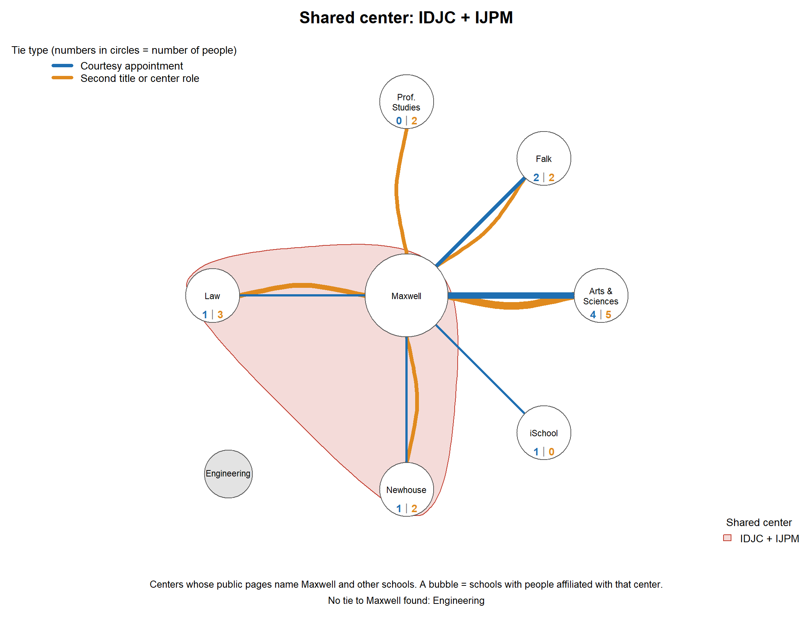

# Overview

Universities describe themselves as places where schools work together, but the organization chart does not show how connected the schools actually are. This project asks a narrow question that public data can answer: **which of Syracuse University's schools are linked through people who hold a role in more than one of them, and where might a gap be worth closing?**

How well people in different schools communicate cannot be observed from the outside. So the network uses something that is visible: a person whose faculty-directory entry names a second school. The data come mainly from the Maxwell School's faculty directory, the one source that was searched completely. The result is the *ego network* of the Maxwell School: Maxwell, the schools directly tied to it, and the centers that bring Maxwell and other schools together. It is a pilot. The files are set up so that other people can add other schools.

# The network

## Nodes

The nodes are the 13 schools and colleges on Syracuse University's official list: Architecture, Arts and Sciences, Education, Engineering and Computer Science, Falk College of Sport, Information Studies (the iSchool), Law, Whitman School of Management, Maxwell, Newhouse, Visual and Performing Arts (VPA), the Graduate School, and Professional Studies. Units inside a school roll up to it. For example, the School of Design and the Department of Drama belong to VPA, and the Political Science and Anthropology departments belong to Maxwell. The figures show Maxwell, the six schools it connects to, and Engineering where it appears in a shared center.

## Edges (ties)

A tie between Maxwell and another school is **a person** whose entry in Maxwell's faculty directory links the two schools. There are two kinds:

- **Courtesy appointment.** The entry says "by Courtesy Appointment" and the person's home school is elsewhere. This is the strictest tie, because the page says so outright.
- **Second title or center role.** The entry lists a second school, or a role in a center, without the courtesy wording. This is a looser tie, because the page does not say how formal it is.

The **weight** of an edge is the number of people. The network is **undirected**: a line means people link the two schools, not which way. Because a pair of schools can be linked by both kinds of tie, a pair can have two parallel lines, one blue and one orange.

Not counted as ties: people whose two roles are inside the same school, university offices (such as the Office of Research), outside institutions (such as SUNY ESF), students, and editors of a book someone contributed to.

## Shared centers (groupings)

Some centers bring people from several schools together. A center whose public page names people from at least two schools is drawn as a shaded bubble around those schools. A bubble is a grouping, not a tie. Three centers include Maxwell: the Institute for Democracy, Journalism and Citizenship (IDJC), the Institute for the Study of the Judiciary, Politics & the Media (IJPM), and the Institute for Security Policy and Law (ISPL). IDJC and IJPM name the same schools (Law, Maxwell and Newhouse), so they share one bubble.

## How the figures encode the network

| Element | What it shows |
|:------------------------|:--------------------------------------------------|
| Circle | A school. Maxwell is in the middle and larger because it has the most partners. |
| Line color | Tie type: blue is a courtesy appointment, orange is a second title or center role. |
| Line width and numbers | The number of people. The exact counts are printed in each circle (blue number, then orange number). |
| Grey circle | No tie of that type was seen. In the bubble figure, a school with no tie to Maxwell. |
| Shaded bubble | A shared center. |
| Layout | Placed by hand on a ring, with schools that share a center next to each other so each bubble stays compact. |

# Data

## Sources

All data are from public Syracuse University web pages, read in November 2026.

- **Maxwell School faculty directory**, pages 1 to 8: <https://www.maxwell.syr.edu/directory/faculty> (the other pages add `?page=2` through `?page=8`). Every tie in the Maxwell-centered figures comes from this source.
- **The list of schools:** SU's schools and colleges page (<https://www.syracuse.edu/academics/schools-colleges/>) and the Faculty Manual, section 1.3 (<https://academicaffairs.syracuse.edu/faculty/policies-and-procedures/faculty-manual/1-3-schools-and-colleges/>).
- **Centers:** the IDJC team and affiliated-experts pages (<https://idjc.syracuse.edu/>), the ISPL affiliated-faculty page (<https://securitypolicylaw.syr.edu/>), and the College of Law's page for IJPM (<https://law.syracuse.edu/academics/centers-institutes/institute-for-the-study-of-the-judiciary-politics-the-media/>).
- Individual profile pages at several schools were opened to check where a person's home school is.

## Steps taken before the R script

1. **Setting the boundary.** The list of 13 schools was cross-checked against the two SU sources above.
2. **Reading the directory.** Each person's title lines were read for a courtesy appointment or a second school. Pages 2 to 8 were read with the help of an AI assistant (Claude, by Anthropic). Page 1 was searched by the author with keywords ("courtesy", "College of", "School of" and school names). The author also compared the page 7 entries against their own copy of the page.
3. **Coding.** Each person who links two schools became one row in `edges_evidence.csv`, with the two schools, the tie type, a short summary of the wording, the source page, and a confidence label (strong, moderate or weak). Rows were also marked if the title is retired (emeritus).
4. **Rules.** Units were rolled up to their school, and the exclusions listed above were applied. Women's and Gender Studies was treated as part of Arts and Sciences because a Maxwell directory title says so.
5. **Checking.** Eight rows (five uncertain ones and three strong ones) were checked against their source pages and none was wrong as a tie. In all, 21 of the 23 Maxwell rows were confirmed by a second, separate reading.
6. **Centers.** Center membership was taken from each center's public pages, which name the schools or list people with their schools.
7. **Counting.** The R script then counts the people for each pair of schools and tie type. The result is also saved as `edgelist_maxwell.csv`.

<!-- EDIT: check your course's policy on AI assistance. Keep, edit or remove the sentence about the assistant in step 2, and the sentence below. -->
The R script was written with the same assistant and run by the author.

# What is noteworthy

The Maxwell directory shows **23 people** who link Maxwell to six other schools. @fig-star shows them, and the table gives the counts.

{#fig-star fig-alt="A star-shaped network with Maxwell in the middle and six schools around it, joined by blue and orange lines of different widths. Numbers inside each school's circle give the counts." width=90%}

| School | Courtesy appointment | Second title or center role | Total |
|:---------------------|-----------:|-----------:|-----:|
| Arts and Sciences | 4 | 5 | 9 |
| Falk | 2 | 2 | 4 |
| Law | 1 | 3 | 4 |
| Newhouse | 1 | 2 | 3 |
| Professional Studies | 0 | 2 | 2 |
| iSchool | 1 | 0 | 1 |
| **All six** | **9** | **14** | **23** |

: People linking Maxwell to each partner school.

**What stands out**

- **Arts and Sciences is the largest partner.** Nine of the 23 people, about two in five, link Maxwell to Arts and Sciences, and it is the only partner with a substantial number of both tie types.
- **Schools differ in the kind of tie.** Law's ties are mostly second titles and center roles (three of four). The iSchool's single tie is a courtesy appointment. Professional Studies has no courtesy appointments at all, and its two ties are administrative roles that Maxwell faculty hold there.
- **Six schools have no tie to Maxwell here:** Architecture, Education, Engineering, the Graduate School, VPA and Whitman. This means none was seen in Maxwell's directory, not that none exist.
- **The star shape is partly built in.** Maxwell has six partners and every partner has one, so network measures such as degree (Maxwell 6) and betweenness say little. Maxwell looks like a hub partly because its directory is where the search took place.

{#fig-courtesy fig-alt="The same star network drawn with only blue lines for courtesy appointments. Professional Studies is grey because it has none." width=80%}

**Shared centers.** @fig-bubbles adds the centers that include Maxwell.

{#fig-bubbles fig-alt="The star network with two overlapping shaded bubbles around groups of schools. One bubble holds Law, Maxwell and Newhouse; a larger one also holds the iSchool and Engineering." width=100%}

- **Law and Newhouse share all three of Maxwell's centers** (one of them, IJPM, is currently on hiatus). Both are tied to Maxwell, but the data show no one linking Law and Newhouse directly. That tie was never searched for, so it is a lead, not a finding.
- **The iSchool shares a center with both Law and Newhouse** (ISPL), and again no direct tie was searched for.
- **Engineering is the only school in a Maxwell center with no tie to Maxwell.** Engineering faculty are listed with ISPL.

**Connecting back to network ideas.** In an ego network, the interesting question is whether a node's partners are connected to each other. Maxwell's six partners could be joined by 15 possible ties, and none of those 15 was searched. Where two partners both tie to Maxwell but not to each other, the group of three is an open triad, which is the kind of gap a leader might try to close. The three pairs that already share a Maxwell center (Law and Newhouse, Law and the iSchool, the iSchool and Newhouse) are the natural ones to test first.

**Beyond Maxwell (a sample only).** The same evidence table holds a few ties between other schools, found while following leads: five Arts and Sciences faculty (one of them identified only from a department name) advise Newhouse's Goldring master's program, two VPA faculty do the same, and there are single links such as a Newhouse and Education project. These were not searched for systematically, so they are not drawn here.

# How far to trust it

- **One source was searched completely.** Maxwell's directory was read on all 8 pages, but page 1 was searched by keyword and not read line by line. No other school's directory was searched for any tie type. A school with no line means "none seen."
- **Ties are only the ones written down.** A school's own pages often do not mention a connection that Maxwell's page does: in five spot checks, two mentioned it. Silence on a page is not evidence of no tie.
- **Not every person counts the same.** Five of the 23 Maxwell rows are retired titles, and four are marked weak (affiliate-only titles, a title that may be an endowed chair, or a school the page does not name). The evidence table records this for every row.
- **Presence on a page is not collaboration.** A title shows a formal link, not how well people communicate. Interviews or a short survey with faculty and administrators would be the way to test that.
- **Co-authored publications were tested and set aside.** The university's repository records one school per item and no school for each author, so there was no reliable way to link authors to schools in the time available.

# What to do next

1. **Test the three leads.** Search Law's directory and bios for "Newhouse," and Newhouse's for "College of Law," then do the same for the other two pairs.
2. **Divide the rest by school.** Each person on a team takes one school's directory, bios and center pages, adds rows to `edges_evidence.csv`, and reruns the script. The 15 untested pairs are listed in `figures/maxwell_untested_pairs.csv`.
3. **Add a second kind of evidence.** Interviews or a survey could show whether the ties on the page are ties in practice.

# Reproducing this work

All files are in the project folder.

| File | What it is |
|:-------------------------|:------------------------------------------------------|
| `network_figures.R` | The R script. It reads the CSV files and draws the figures and tables with igraph. |
| `nodes.csv` | The node list: the 13 schools. |
| `edgelist_maxwell.csv` | The edge list used in the figures: the two schools, tie type, and number of people. |
| `edges_evidence.csv` | One row per person, program or center that links two schools, with sources and confidence. |
| `centers.csv` | Which schools belong to each shared center. |
| `layout.csv` | The hand-placed positions. |
| `figures/` | The figures and tables the script produces. |

To rerun it, open R in the project folder, run `install.packages("igraph")` once, then `source("network_figures.R")`.



# Appendix

## Node list

| Code | School |
|:-----|:-----------------------------------------------|
| ARCH | School of Architecture |
| AS | College of Arts and Sciences |
| EDU | School of Education |
| ECS | College of Engineering and Computer Science |
| FALK | Falk College of Sport |
| ISCH | School of Information Studies (iSchool) |
| LAW | College of Law |
| WHIT | Martin J. Whitman School of Management |
| MAX | Maxwell School of Citizenship and Public Affairs |
| NEW | S.I. Newhouse School of Public Communications |
| VPA | College of Visual and Performing Arts |
| GRAD | Graduate School |
| PROF | College of Professional Studies |

## Edge list used in the figures

| From | To | Tie type | People |
|:-----|:----|:-----------------|-----:|
| AS | MAX | Courtesy | 4 |
| FALK | MAX | Courtesy | 2 |
| ISCH | MAX | Courtesy | 1 |
| LAW | MAX | Courtesy | 1 |
| MAX | NEW | Courtesy | 1 |
| AS | MAX | Second title or center role | 5 |
| LAW | MAX | Second title or center role | 3 |
| FALK | MAX | Second title or center role | 2 |
| MAX | NEW | Second title or center role | 2 |
| MAX | PROF | Second title or center role | 2 |

## More figures

{#fig-broad fig-alt="The star network drawn with only orange lines for second titles and center roles. The iSchool is grey because it has none." width=80%}

{#fig-ispl fig-alt="The star network with one shaded bubble around Law, Maxwell, Newhouse, the iSchool and Engineering." width=95%}

{#fig-idjc fig-alt="The star network with one shaded bubble around Law, Maxwell and Newhouse." width=95%}
